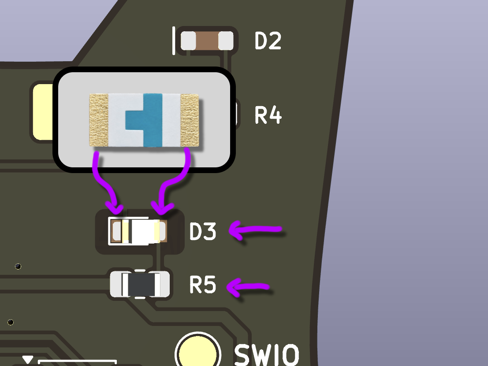
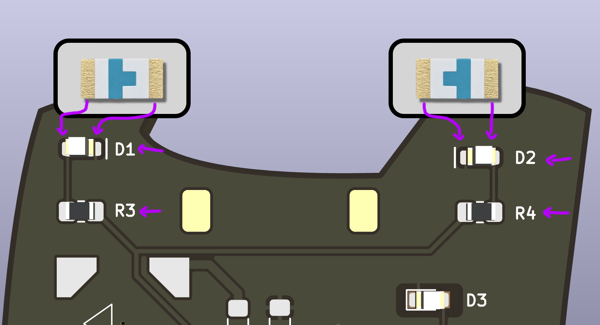
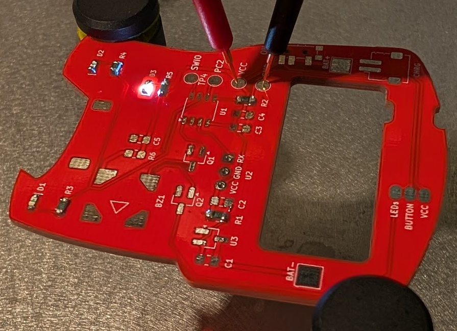
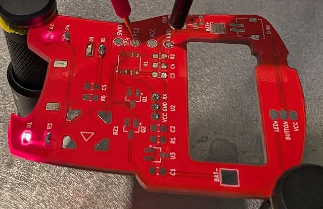
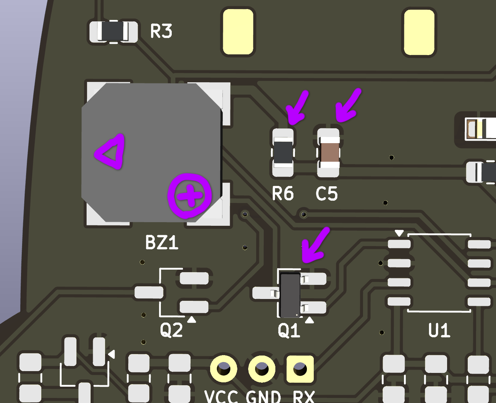
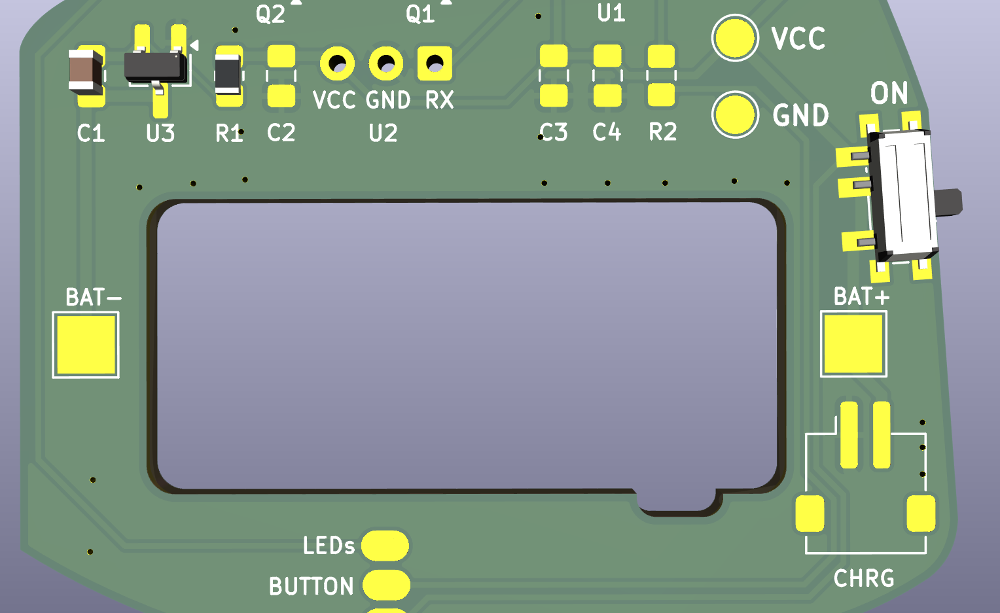
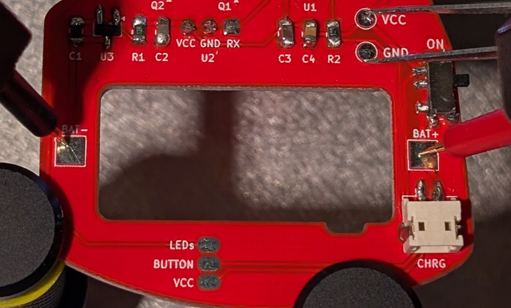
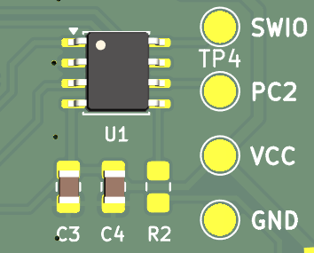
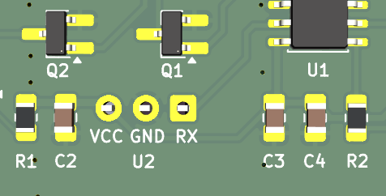
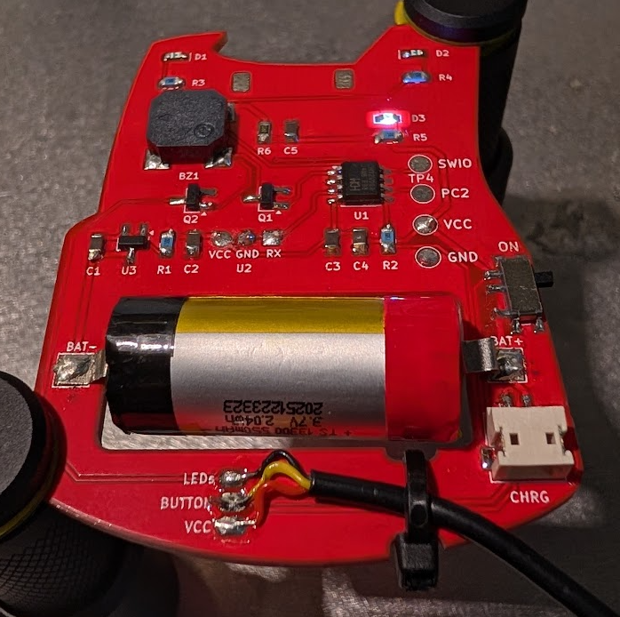

# Pocket Tag Girls' Night
Tiny laser tag for Elab girls' night!

# Assembly instructions

### 1. LED + resistor for LOGO
Components: 
- white LED for D3
- 120Ω for R5

Note the direction of the LED
Light should point DOWN

### 2. LEDs + resistors for shoulder pads
Components:
- red LEDs for D1 and D2
- 120Ω for R3 and R4

Note the direction of the LEDs
Light should point DOWN

### Test time!

Apply 3.3V between VCC and GND on the test points. The LED under the logo should now light up.

Apply 3.3V between PC2 and GND on the test points. The LEDs on the shoulder pads should now light up.

### 3. Buzzer with components
Components:
- Buzzer for BZ1
- 2302 for Q1
- 0Ω for R6
- 22nF for C5

Note the direction of the buzzer.

### 4. Power and battery protection

Components: 
- 1µF for C1
- XB3303A for U3
- 120Ω for R1
- Switch for SW1
- Charging connector for CHRG

### Test time!

With the board powered, short the test points VCC and GND using tweezers or other conducting material. The LED should turn off within a second and the board should then stay off until power cycled. 

### 5. Microcontroller and decoupling capacitors
Components:
- 1µF for C3
- 22µF for C4
- CH32V003 for U1

### 6. Receiver

Components:
- 1µF for C2
- VS838 for U2

The receiver is mounted on the other side of the PCB, otherwise no one can hit you and that is cheating. Insert the legs and bend the receiver to fit in the square on the PCB before soldering.

### 7. Transmitter
Components:
- 2302 for Q2
- 120Ω for R2

### 8. Battery and cable
Solder the black side of the battery to BAT- and the red side to BAT+. Solder the cable and attach a zip tie for strain relief.

